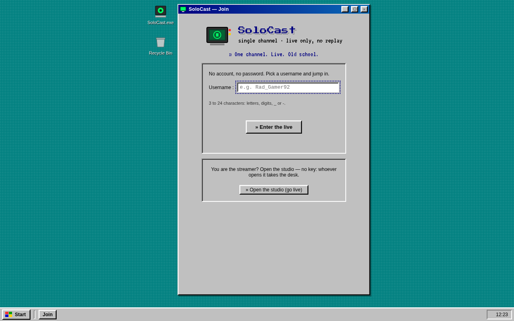
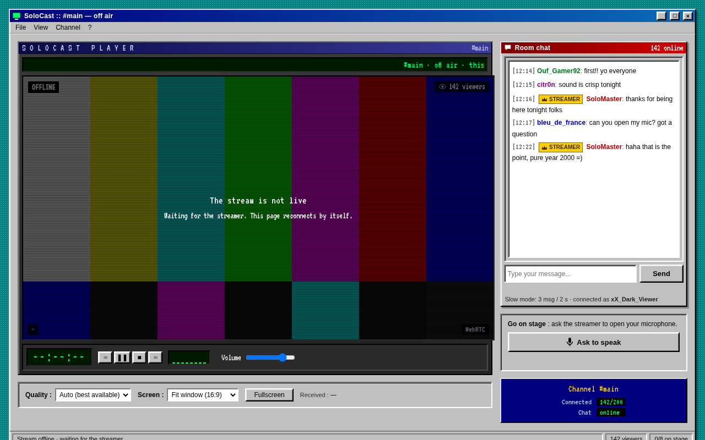
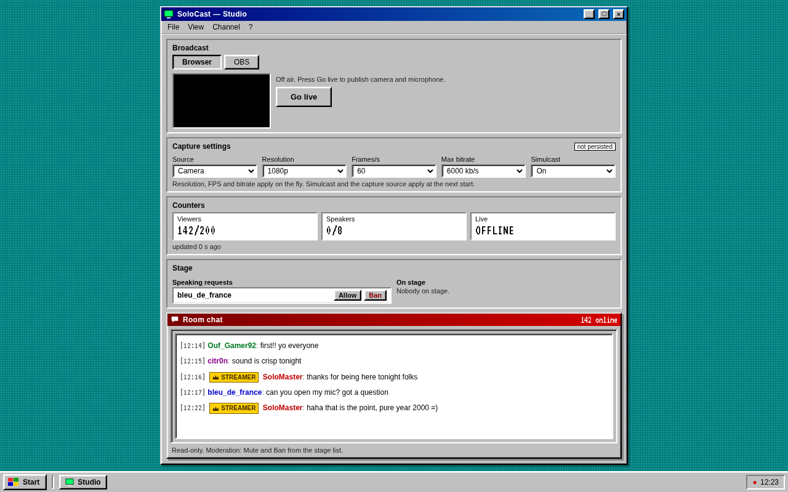

# SoloCast

A simple streaming site designed for a single user: a streamer broadcasts, viewers watch, and everyone participates in the chat. It features a video player, a real-time chat, and a queue for viewers who want to be invited on screen. The interface is intentionally styled to resemble websites from the early 2000s.

This was created for broadcasting to a small group of people, not as a general-purpose platform. There are no accounts or databases; a simple username is all that's needed to join.



## Features

The viewing page: video player, chat, and a button to request to speak.



The streamer's studio: browser broadcasting, capture settings, counters, a queue for viewers requesting to speak (with options to allow or ban), a read-only chat for moderation, and the sharing controls.



The screenshots are from the mock mode (`NEXT_PUBLIC_BACKEND_MODE=mock`), so the video player is "offline": there's no actual video stream behind it.

## Install and run

Download the file for your system from the latest [release](../../releases):

| System                  | File                       | Installation                                                         |
| ----------------------- | -------------------------- | -------------------------------------------------------------------- |
| Windows 10/11 (x64)     | `SoloCast-Setup-x.y.z.exe` | double-click; installs for the current user, no administrator rights |
| Debian / Ubuntu (amd64) | `solocast_x.y.z_amd64.deb` | `sudo apt install ./solocast_x.y.z_amd64.deb`                        |

Everything is bundled (Node, the LiveKit video server, cloudflared): nothing else to install, no
Docker, no configuration file.

**SoloCast** then shows up in the Start menu (Windows) or the applications menu (Linux). One click
opens the studio in your browser. There is no terminal and no command-line option: everything is
set from the studio.

- **Sharing**: the _Share_ button opens a public `https://….trycloudflare.com` address to send to
  your viewers. It changes every time, and your choice is remembered for the next launch. Off by
  default.
- **Studio**: only the computer running SoloCast can open it. Viewers arriving through the public
  address can only watch and chat.
- **Quit**: the _Quit SoloCast_ button in the studio. Launching the app again while it runs simply
  reopens the studio.
- Settings: `%APPDATA%\SoloCast` (Windows), `~/.config/solocast` (Linux). Log and session state:
  `%LOCALAPPDATA%\SoloCast-state` (Windows), same folder as the settings (Linux).
- Windows installs to `%LOCALAPPDATA%\Programs\SoloCast`, no administrator rights. Silent install:
  `SoloCast-Setup-x.y.z.exe /S`. The uninstaller stops a running SoloCast and keeps your settings
  unless you tick the box.

Good to know:

- **Video for remote viewers.** The tunnel carries the site and the chat, not the video stream
  (WebRTC). For viewers outside your home network to receive video, forward **TCP 7881** and
  **UDP 7882** on your router to this computer (the studio reminds you). Without it they see the
  chat but the player stays "offline". This is not possible on every connection (mobile data, some
  providers). Playing between two machines on the same local network has not been verified.
- **No OBS in the standalone install**: you broadcast from the browser (camera or screen share).
  OBS/RTMP needs the LiveKit Ingress (Docker), see §Development.
- **Windows SmartScreen**: the installer is not signed, so Windows shows a warning the first time
  ("More info", then "Run anyway").
- **Windows Firewall**: for viewers outside your network, tick _Allow video for remote viewers_ in the
  installer (one administrator prompt), or allow `livekit-server.exe` when Windows asks.

## How it is tested

Every release runs, on real machines, before anything is published: the installer is installed
silently on **Windows (windows-latest)**, launched exactly like the Start menu shortcut, exercised
(site, API, studio lock-down, chat WebSocket through the proxy, video server, public link), launched
a second time (must reuse the running instance), quit from the API, then uninstalled **while it is
running**. The `.deb` goes through the same scenario on **Debian 12, Ubuntu 22.04 and Ubuntu 24.04**,
including install and removal. See `scripts/smoke.mjs` and `.github/workflows/release.yml`.

## Code Organization

Monorepo using pnpm:

- `apps/web`: the frontend, built with Next.js (exported as a static site for the installed app)
- `apps/backend`: the API, the chat WebSocket and the launcher (`src/launcher/`), built with Fastify
- `packages/shared`: shared Zod contracts used by both
- `packaging/` + `scripts/package.mjs`: builds the `.deb` and the `.exe` installer
- `deploy/docker-compose.yml`: Redis + LiveKit + Ingress, for a server deployment

## Development

Prerequisites: Node >= 20 (22 recommended) and pnpm 9 (`npm i -g pnpm@9.15.9`).

```sh
pnpm install
cp .env.example .env
pnpm dev
```

- Frontend: http://localhost:3001 (username selection, then `/watch`)
- Streamer Studio: http://localhost:3001/studio (no key required: whoever opens the page gets the studio)
- Backend: http://localhost:3000 (`GET /health`)

Works without Docker: viewer identity, WebSocket chat, presence, request to speak, moderation.
`STATE_BACKEND=memory` keeps all the state in the backend process (lost on restart). An
`apps/web/.env.local` with `NEXT_PUBLIC_BACKEND_MODE=mock` runs the frontend alone, without a
backend.

Run the installed application as-is from the repository (no package):

```sh
pnpm launch
```

It builds the static site and the launcher bundle, then starts. Without `livekit-server` or
`cloudflared` next to it (they only come with the packages), video and sharing are unavailable:
the chat works.

### Video and OBS in development (Docker)

```sh
docker compose -f deploy/docker-compose.yml up -d redis livekit ingress
```

The `LIVEKIT_*` keys in `.env` are used by the SFU, the backend (signed tokens) and the OBS ingress
(`rtmp://localhost:1935/x/<stream-key>`). Ports and budgets are documented in the compose file.

The "live" flag of `presence:update` is `true` only when the SFU reports the streamer through the
`participant_joined` webhook. Under Docker the container reaches the host through
`host.docker.internal`: start the backend with `BACKEND_HOST=0.0.0.0` (and allow port 3000 on
`docker0` if a firewall runs). This is not needed in the installed app, where the SFU runs on the
same machine.

## Publishing a release

```sh
git tag v0.2.0 && git push origin v0.2.0
```

The `.github/workflows/release.yml` workflow runs lint, types and tests, builds the `.deb` and the
`.exe` on an Ubuntu runner (`node scripts/package.mjs`), then attaches them to the release with a
`SHA256SUMS` file. The bundled binaries (Node, LiveKit, cloudflared) are pinned by version and
SHA-256 in `scripts/package.mjs`. Dry run: start the workflow by hand, the installers come out as
artifacts.

Build locally: `pnpm package` (needs `dpkg-deb` and `makensis`, i.e. `apt install dpkg nsis` or
`pacman -S dpkg nsis`).

## Quality

```sh
pnpm lint         # ESLint (root flat config, strict typing)
pnpm typecheck    # tsc --noEmit on the 3 packages
pnpm test         # Vitest
pnpm format       # Prettier
pnpm build        # shared + backend (tsc) + web (next build)
pnpm package      # .deb + .exe in dist/release/
```

Playwright E2E (frontend only, mock backend): `pnpm --filter @solocast/web test:e2e`
(viewer walkthrough + studio), all passing. The test server is started by Playwright on port 3101
with `NEXT_PUBLIC_BACKEND_MODE=mock`: neither the backend nor LiveKit is required.
